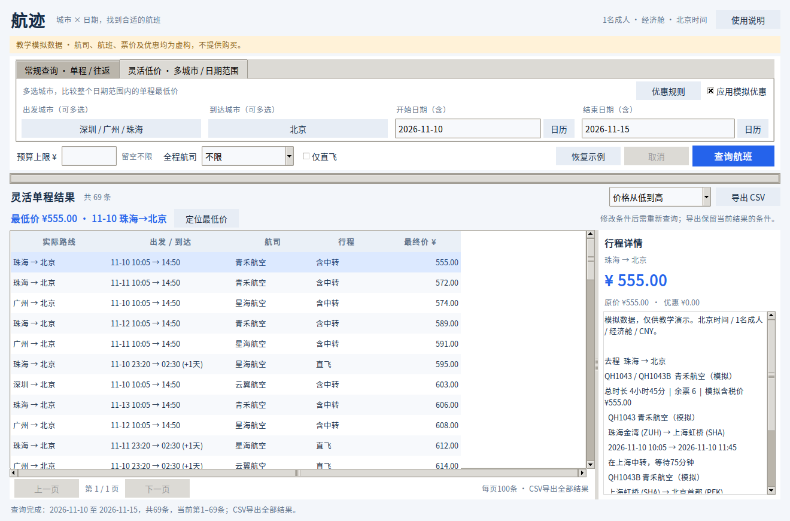

# 航迹 FlightFinder 1.0

INT6181 Python桌面课程项目。Python 3.11+、Tkinter与标准库，无需pip安装项目依赖。所有航司、航班、价格、优惠均为本地虚构教学数据，无网络请求、不购买。

## 启动

完整解压后，在PyCharm选择带Tkinter的Python解释器，运行项目根目录main.py，或在终端执行：

```console
python main.py
python main.py --check
```

`--check`不打开窗口。默认JSON路径相对于main.py，因此可从其他工作目录启动。自定义文件可用`--data 路径/flights.json --discount 路径/discount.json`。Windows官方Python安装需保留Tcl/Tk组件；Linux可能需要系统Tk组件。`python -m tkinter`可检查安装。建议窗口1320×870；支持1030×650，表格可水平滚动，详情可垂直滚动。

## 联合查询示例

1. 打开“灵活低价 · 多城市 / 日期范围”。点击城市按钮，通过复选框选择城市，无需按Ctrl。
2. 出发选择深圳、广州、珠海，到达选择北京；开始2026-11-10，结束2026-11-15。日期支持直接输入或日历选择，首尾均包含。
3. 勾选“应用模拟优惠”，预算留空、航司不限、取消“仅直飞”，点击“查询航班”。
4. 当前固定数据产生69条结果，其中5条有优惠；最低价555.00元，11月10日珠海至北京（该最低价本身无优惠）。这是模拟数据计算结果。
5. 可再设置预算、航司和直飞，**城市×日期与优惠共同生效**。先计算优惠，再检查预算，最后全局排序和选择最低价。优惠开关修改后需重新查询。
6. 选中结果查看原价、优惠、最终价与航段。“惠”表示有优惠；“定位最低价”可跨页定位。
7. 每页100条；导出CSV包含全部结果、实际城市日期、原价/优惠/最终价与查询条件，而非只导出当前页。



“常规查询”保留指定日期单程/往返。往返是两张独立模拟单程票的组合；返程起飞严格晚于去程到达，总价为去返程之和。常规查询保留原价；需要在指定单日使用优惠时，在灵活查询中将开始和结束设为同一天。灵活查询当前仅支持单程，并非“多段连续旅行”。

查询在后台运行，可取消；切换模式会清空结果。错误输入不会保留旧结果。编辑输入后，现有列表和CSV仍使用上次查询快照，重新查询才更新。Enter查询、Esc取消、Ctrl+E导出（按钮和弹窗保留自身键盘行为）。

## 模拟数据与优惠配置

`data/flights.json`与v0.1保持一致：固定7城市、2026年11月1日至30日、2880条单程报价。不是每条路线都有报价。`tools/generate_demo_data.py`无网络、无随机数，执行后覆盖为同样的数据；程序每次启动只读取，不重新生成。查询不与今天比较，以保证课程演示可复现。灵活日期范围限制在数据覆盖内且最多31天；常规查询在覆盖外返回空结果。

`data/discount.json`配置示例：

```json
{"enabled": true, "airline": "云翼航空（模拟）", "threshold_cents": 80000, "reduction_cents": 5000, "start_date": "2026-11-01", "end_date": "2026-11-30"}
```

金额单位为整数分，上例为满800减50。按每张单程报价计算，所有航段必须属于该航司，适用日期为出发日期，含起止日期；门槛含等号，优惠不超过原价，不叠加。预算按最终价判断（0为零预算，空白才不限）。JSON需严格使用这六个字段，布尔、金额和日期须符合格式；错误配置阻止启动并给出提示。修改配置后重启生效。设置enabled为false或界面取消勾选可关闭优惠。原始Flight票价不变。

固定1名成人、经济舱、CNY，原价为模拟含税总价。时间均为北京时间，售罄不返回；指定航司要求每个航段都符合。价格排序相同则按起飞时间及ID稳定排序。CSV采用UTF-8 BOM，中文可供Excel读取；写入失败不覆盖已有文件。

## 检查与CI

```console
python -m compileall -q main.py flight_app tests tools
python tools/run_tests.py --require-gui
python main.py --check
```

无桌面时可用`python -m unittest discover -s tests -v`运行业务测试，GUI明确跳过；不能把跳过当作GUI通过。随包提供本次实测记录`docs/test_results.json`与说明`docs/verification.md`。

GitHub Actions配置为Windows/Python3.12，push到test、beta、master或向beta/master提交PR时执行编译、包含GUI的测试、自检。仅用三个分支：test→beta→master，master只由组长合并。工作流不能自动设定分支权限，管理员仍需在GitHub仓库规则中配置。当前没有远程CI执行记录。

升级方法见`UPGRADE.md`，架构见`docs/architecture.md`，审查见`docs/code_review.md`。最终课程材料见`docs/submission_checklist.md`；软件功能完成不等于全部课程提交已完成。请按实际开发与验证情况说明AI辅助，保留真实贡献记录。
