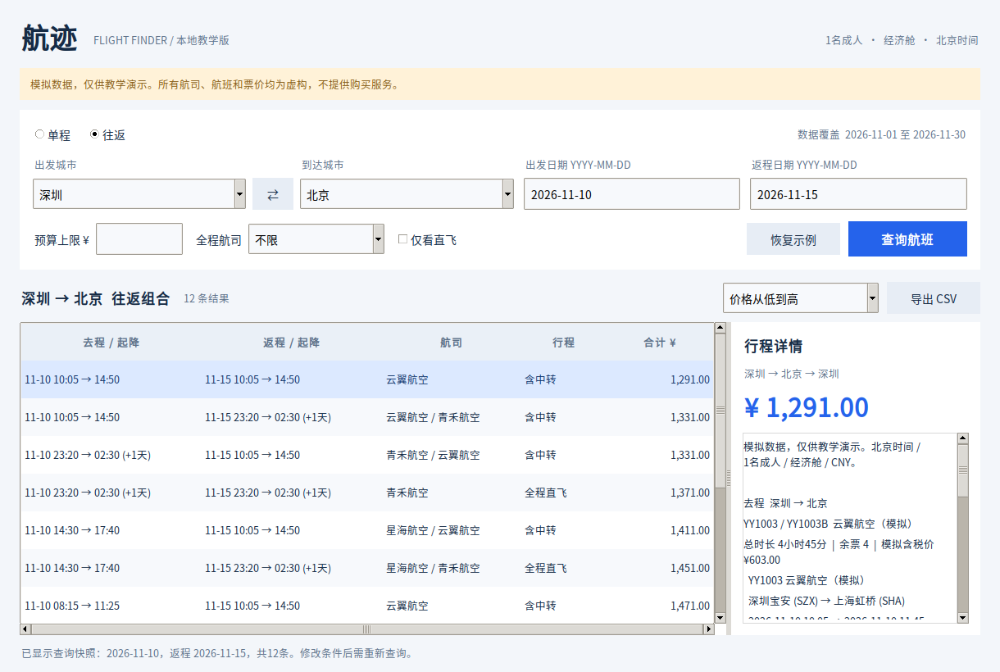

# 航迹 本地模拟机票查询

INT6181 Python课程项目初版，使用Tkinter开发PC桌面GUI。所有数据均为本地固定模拟数据，不调用第三方API，不启动HTTP服务，不操作浏览器。

**模拟数据仅供教学演示，不能用于真实出行。** 航司、航班号、价格及余票都是自行编写的示例。原价为模拟含税总价，不另加费用，也不代表任何平台的真实报价。

## 1 运行

环境：Python **3.11或以上**，并带有Tkinter和可用桌面显示。建议在Windows官方Python安装程序中保留Tcl/Tk组件。项目只使用Python标准库，**无需pip安装项目依赖**。Linux的某些Python发行版需要另外安装系统的Tk组件。

将整个文件夹解压后，在项目目录打开终端：

```console
python main.py
```

如果电脑使用Python启动器，可运行 `py main.py`。不要只复制main.py，必须同时保留flight_app和data目录。无需打包EXE。运行环境建议屏幕宽度至少1100像素，可缩放窗口并滚动表格。

检查Tk是否安装：

```console
python -m tkinter
```

无桌面环境也可以进行数据与业务自检：

```console
python main.py --check
```

从其他工作目录运行也受支持，默认数据路径相对于main.py定位。也可以用 `python main.py --data 路径/flights.json` 指定同格式的模拟数据。

## 2 第一次试用

数据固定覆盖 **2026-11-01至2026-11-30**，7个城市共2,880条单程报价。包括直飞、中转、跨日到达、余票为0和多种价格。

1. 默认深圳到北京，出发日期2026-11-10，点击“查询航班”。
2. 选中“往返”，返程2026-11-15，再次查询。
3. 试用预算上限、全程航司和“仅看直飞”。筛选条件改变后需重新点击查询。
4. 在排序框中切换价格或起飞时间排序；选中结果，在右侧查看航段及价格明细。
5. 点击“导出CSV”，导出当前结果快照，顺序与列表一致，含查询条件和模拟标记。
6. 将预算设为0可演示无结果；输入错误日期可演示提示。点击“恢复示例”会清空旧结果。

支持路线：深圳—北京、广州—北京、珠海—北京、深圳—上海、深圳—大同、广州—太原、珠海—太原、北京—上海、北京—大同、上海—太原、深圳—太原、广州—大同，均含反向。其他城市组合可能无结果，这是正常状态。

## 3 初版规则

界面示例（Linux Tk8.6测试环境；Windows外观可能略有不同）：



- 固定1名成人、经济舱、人民币；内部金额用整数分，北京时间使用带+08:00时区的datetime。
- 往返为两张独立模拟单程票的组合，总价等于去返程之和，并非真实往返联票。
- 返程起飞必须严格晚于去程到达。同一天往返可以查询，但不能选择无法衔接的组合。
- 预算针对单程合计或往返两程总价，包含边界。留空不限；0元不代表不限。
- 已售罄报价不返回。指定航司要求去程、返程及中转的每个航段都满足。
- 价格排序以最终价格、去程起飞时间及行程ID依次比较；时间排序依次比较去程时间、返程时间、价格及ID。
- 初版优惠金额为0，但基础价格和优惠后价格已经分开。日期范围、多城市搜索和优惠规则引擎尚未实现。
- 查询日期不与今天比较，便于以后复现固定教学案例；超出数据日期返回空结果。
- 条件输入与结果是不同快照。导出使用产生当前结果的条件，不会混入尚未查询的新输入。

## 4 测试

```console
python -m unittest discover -s tests -v
```

共45项测试：37项业务和数据测试、8项GUI集成测试。业务测试不需要GUI。GUI集成测试需要Tk与桌面显示，没有显示时明确显示skipped。测试包括预算边界、往返组合、跨日衔接、价格扩展、数据损坏、排序、CSV中文、导出失败不覆盖原文件等。此次实际验证结果见docs/verification.md。

`.github/workflows/tests.yml` 已提供Python 3.11至3.14的GitHub Actions配置。上传仓库后才会实际执行；本地通过不代表这些版本的远程检查已经通过。GUI测试不会在无显示的默认CI环境执行。

## 5 扩展与协作

见 `docs/architecture.md` 和 `AGENTS.md`。GUI只依赖统一查询结果，计价策略和数据源可替换。不要将复杂业务写进按钮回调。

本地数据生成器：

```console
python tools/generate_demo_data.py
```

生成器无网络、无随机数，重复执行产生相同数据；它会覆盖data/flights.json，手动修改前请备份。

## 6 当前边界

- 仅交付本地初版，不包含购买、实时票价、多乘客、优惠功能、日期范围或多城市组合搜索。
- 文件格式错误会拒绝加载整个数据集，避免静默丢弃问题记录。
- 初版查询在GUI主线程处理受控的本地单日期数据；后续扩大组合规模时，应增加后台任务、取消及进度机制。
- Tk的具体外观会随操作系统、主题和缩放变化。Windows环境仍应由组员完成实际验收。
- 没有成员贡献或人工PR审查的虚构记录；成员应基于实际后续工作保留证据。

本初版由Codex根据小组已确认的范围辅助生成。请理解负责的模块、实际测试，并在课程报告中如实说明AI协作内容。
